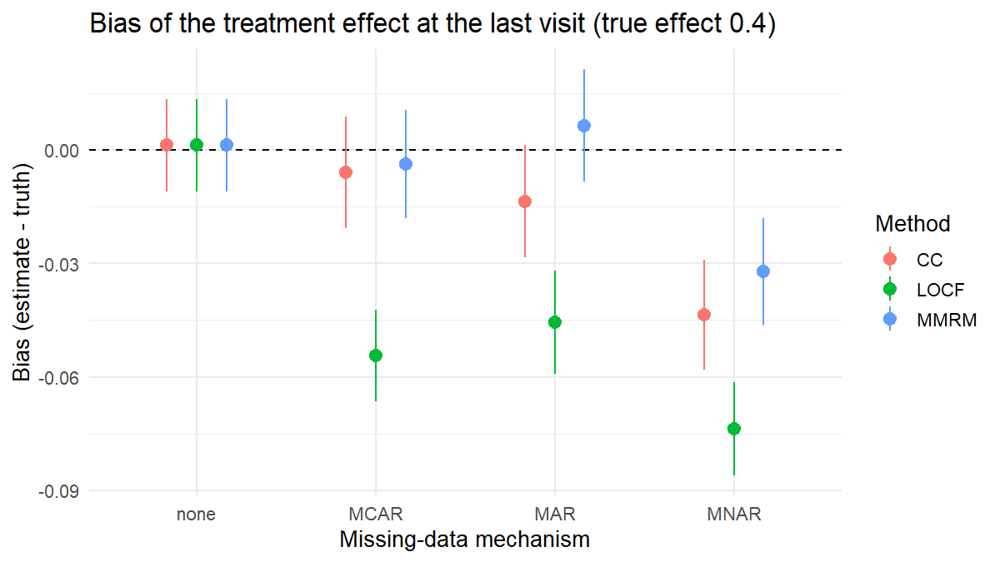

# Missing Data in a Randomized Clinical Trial: A Simulation Study in R

How much does patient dropout distort the estimated treatment effect, and which analysis method holds up? This project compares three common methods across four missing-data mechanisms with a Monte Carlo simulation study.

## Design (ADEMP, Morris, White & Crowther 2019)

**Aim.** Compare bias, precision, confidence-interval coverage, type I error and power of three analysis methods when patients drop out of a two-arm trial.

**Data-generating mechanism.**
- Two arms, 100 patients each, one baseline value and 4 post-baseline visits
- Outcome on a standardized scale (higher = more improvement), correlated within patients (AR(1), rho = 0.6)
- True treatment effect grows linearly and reaches delta at the last visit: delta = 0 (null) and delta = 0.4
- Monotone dropout after visit 1, about 30 % missing at the last visit:
  - MCAR: dropout unrelated to the outcome
  - MAR: dropout more likely after a poor *observed* value (lack of efficacy)
  - MNAR: dropout depends on the current, *unobserved* value

**Estimand.** Difference in mean outcome at the last visit between treatment and control, had all patients stayed in the study (hypothetical strategy for dropout, ICH E9(R1)).

**Methods.**
1. Complete-case ANCOVA at the last visit, adjusted for baseline
2. LOCF (last observation carried forward), then ANCOVA
3. MMRM with unstructured covariance and visit-specific treatment and baseline effects, fitted with `nlme::gls`

**Performance measures.** Bias, empirical SE, average model SE, coverage of the 95 % CI, rejection rate at alpha = 0.05, each with its Monte Carlo standard error. 500 replicates per scenario, 8 scenarios.

## How to run

```r
# from the repository root, R 4.x with ggplot2 installed
Rscript checks/sanity_checks.R      # about 10 seconds
Rscript run_simulation.R 50         # quick test, a few minutes
Rscript run_simulation.R            # full run, 500 replicates per scenario
```

Results go to `results/` (performance table, raw estimates, three figures).

## How I checked the code

`checks/sanity_checks.R` verifies that:
- a very large simulated trial reproduces the effect size and correlation that were put in
- dropout is monotone and visit 1 is always observed
- the MCAR dropout rate matches the theoretical value 1 - (1 - p)^3
- under MAR, patients who drop out had lower observed values than those who stay
- without missing data, CC, LOCF and MMRM give identical estimates (as theory says)
- the same seed reproduces the same data exactly

Every replicate has its own seed, so any single replicate can be rerun on its own.

## Results

<!-- Write this section yourself after the full run, in your own words.
     Use numbers from results/performance.csv and refer to the figures.
     Suggested: one short paragraph per question below. -->

**Which methods are unbiased under which mechanism?**

**Does coverage stay near 95 %?**

**Is the type I error controlled when there is no treatment effect?**




## Limitations and next steps

- MMRM degrees of freedom use the residual df from `gls`; the `mmrm` package offers Kenward-Roger and Satterthwaite
- Only one MNAR mechanism; reference-based imputation (e.g. jump-to-reference with `rbmi`) and tipping-point sensitivity analyses are the natural next step
- Fixed sample size and effect size; a larger grid would show how results scale
- Cross-check of the MMRM estimates against SAS PROC MIXED is planned

## References

- ICH E9(R1) Addendum on estimands and sensitivity analysis in clinical trials (2019)
- Morris TP, White IR, Crowther MJ (2019). Using simulation studies to evaluate statistical methods. *Statistics in Medicine* 38:2074-2102
- National Research Council (2010). *The Prevention and Treatment of Missing Data in Clinical Trials*
